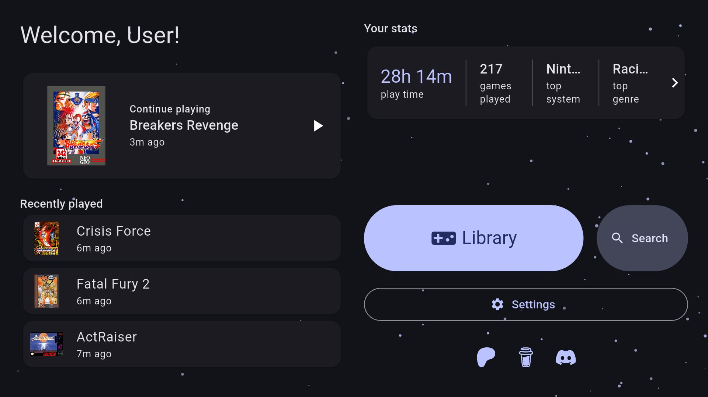
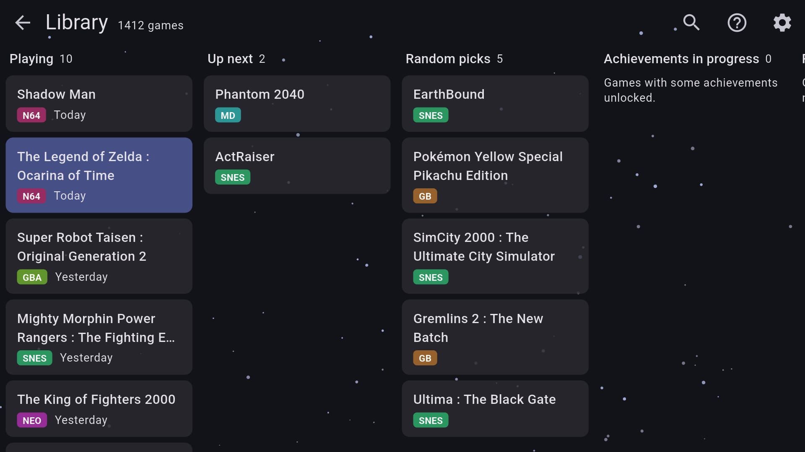

<div align="center">


# Wirá

**A multi-system retro emulator, built from scratch in Flutter.**

*Wirá* (wee-RAH) means **bird** in Tupi/Nheengatu: a nod to Brazil 🇧🇷 and to Dash, Flutter's bird.

*Built with AI assistance: see the [disclaimer](#-ai-disclaimer).*

[](https://willtsan.github.io/wira-site/)
[](https://github.com/willtsan/wira-releases/releases/latest)
[](https://github.com/willtsan/wira-releases/releases)
[](https://www.patreon.com/cw/wira_emulator)
[](https://discord.gg/7HGbFRed7X)
[](https://x.com/wiraemulator)
[](https://buymeacoffee.com/willtsan)

[**🌐 Website**](https://willtsan.github.io/wira-site/) · [**⬇️ Download**](https://github.com/willtsan/wira-releases/releases/latest) · [**🎮 Compatibility**](https://willtsan.github.io/wira-site/compatibility/) · [**🐛 Report a bug**](https://github.com/willtsan/wira-releases/issues) · [**💬 Discord**](https://discord.gg/7HGbFRed7X)

</div>

---

## ✨ What is Wirá?

Wirá plays your favorite classic consoles in one app, with one library. Every emulation core is written from scratch in Dart, so there are no libretro cores and no native emulation code. It runs on **Android** for now, other platforms will come later.

This repository hosts the **release builds**. Everything else lives on the **[website](https://willtsan.github.io/wira-site/)** ([em português](https://willtsan.github.io/wira-site/pt-br/)):

| | |
|---|---|
| 🎮 **[Systems](https://willtsan.github.io/wira-site/systems/)** | Every system Wirá emulates: file types, BIOS needs and what each core supports |
| ✅ **[Compatibility](https://willtsan.github.io/wira-site/compatibility/)** | How games run, system by system. Played something? [Report a game](https://github.com/willtsan/wira-releases/issues/new?template=compat.yml&title=%5BCompat%5D%20) |
| ⬇️ **[Download](https://willtsan.github.io/wira-site/download/)** | The latest build with its checksum, every release, and how to join Wirá Beta |
| 📰 **[News](https://willtsan.github.io/wira-site/news/)** | Release notes and announcements |

<table>
<tr>
<td width="50%"><br><sub>Welcome screen: continue playing, recent games and your stats</sub></td>
<td width="50%"><br><sub>Library lanes: Playing, Up next, Random picks and more</sub></td>
</tr>
</table>

More screenshots and the full feature list are on the [website](https://willtsan.github.io/wira-site/).

## 📦 Installation

1. Open the [latest release](https://github.com/willtsan/wira-releases/releases/latest).
2. Download the `.apk` (Android 7 or later, 64-bit ARM: practically every phone and handheld of the last years).
3. Install it, open Wirá, and point it to your ROMs folder.

> [!IMPORTANT]
> Wirá does **not** include any ROMs or BIOS files. Please use your own legally obtained copies. Each system's page on the [website](https://willtsan.github.io/wira-site/systems/) says which BIOS it needs, if any. Add BIOS files with **Import BIOS** in Wirá's system settings, or put them in its `bios` folder.

## 🧪 Wirá Beta

The standard Wirá is free, and it will stay free. New features land first in **Wirá Beta**, an early-access build for supporters on [Patreon](https://www.patreon.com/cw/wira_emulator).

> [!NOTE]
> **Everything in the beta comes to the standard version.** Patreon pays for test devices, servers and development time; it doesn't lock features away.

**[See what's in the beta right now](https://willtsan.github.io/wira-site/download/#beta-features)**: Sega Saturn, PlayStation, PC Engine CD-ROM², N64 on Vulkan, netplay, rollback and more. The same page explains [how to join](https://willtsan.github.io/wira-site/download/#beta).

## 🚀 Launching from other apps (Android)

Frontends like **ES-DE**, **Daijisho** or **Beacon** can start a game directly with an explicit Intent:

| | |
|---|---|
| Package | `com.willtsan.wira` |
| Activity | `com.willtsan.wira.MainActivity` |
| Extra `rom` (string) | Absolute file path of the ROM (required) |
| Extra `core` (string) | Optional: `nes`, `snes`, `n64`, `gb`, `gbc`, `gba`, `sms`, `gg`, `md`, `neo`, `ngp`, `a26`, `chip8` |

<details>
<summary><b>Details and tips</b></summary>

- **Data URI:** instead of the `rom` extra, the path can be the Intent's data URI (`-d /path/rom.sfc` or `file:///path/rom.sfc`).
- **`core` extra:** case-insensitive. Any extension a system opens also works (`sfc`, `smc`, `gen`, `ngc` and so on). If it's missing, unknown, or shared by two systems (`bin`), the system is detected from the ROM.
- **Real paths only:** `content://` URIs aren't supported. Grant Wirá "All files access" once, from the app or Android settings.
- **While a game is running:** a new launch replaces the current game instead of opening a second copy of the app.
- **Exit:** choosing Exit in the game menu closes Wirá and returns to the frontend.

</details>

<details>
<summary><b>Test from a computer (adb)</b></summary>

```sh
adb shell am start -n com.willtsan.wira/.MainActivity \
  -e rom "/storage/emulated/0/ROMs/snes/Chrono Trigger.sfc" \
  -e core snes
```

</details>

<details>
<summary><b>ES-DE setup</b></summary>

Add Wirá as a custom emulator in ES-DE/custom_systems/es_find_rules.xml:
```xml
<ruleList>
  <emulator name="WIRA">
    <rule type="androidpackage">
      <entry>com.willtsan.wira/.MainActivity</entry>
    </rule>
  </emulator>
</ruleList>
```

Then add a command to the system in ES-DE/custom_systems/es_systems.xml, for example for SNES:
```xml
<command label="Wirá">%EMULATOR_WIRA% %EXTRA_rom%=%ROM% %EXTRA_core%=snes</command>
```

</details>

Other frontends: use the same am start arguments. Pass the ROM's file path, not its URI.

## 💬 Feedback

- **A game runs well or badly?** [Report it](https://github.com/willtsan/wira-releases/issues/new?template=compat.yml&title=%5BCompat%5D%20) for the [compatibility list](https://willtsan.github.io/wira-site/compatibility/).
- **Found a bug?** [Open an issue](https://github.com/willtsan/wira-releases/issues) with the system, the game and what you expected to happen.
- **Just want to chat?** Come to [Discord](https://discord.gg/7HGbFRed7X), where beta news and requests happen too.

## 🤖 AI disclaimer

Wirá and its emulation cores are developed with AI assistance for code generation and opcode translation, while the system architecture, debugging, memory layout, and overall project management are fully human-driven.

## 💚 Support

Wirá is made in spare time. If you enjoy it:

- **[Patreon](https://www.patreon.com/cw/wira_emulator)**: support it monthly and get [Wirá Beta](#-wirá-beta).
- **[Buy me a coffee](https://buymeacoffee.com/willtsan)**: a one-off thank you.

Using the standard version and reporting bugs helps just as much. Thank you! 💚

---

<div align="center">
<sub>Made with 💙 in Portugal by a brazilian, using Flutter.</sub>
</div>
